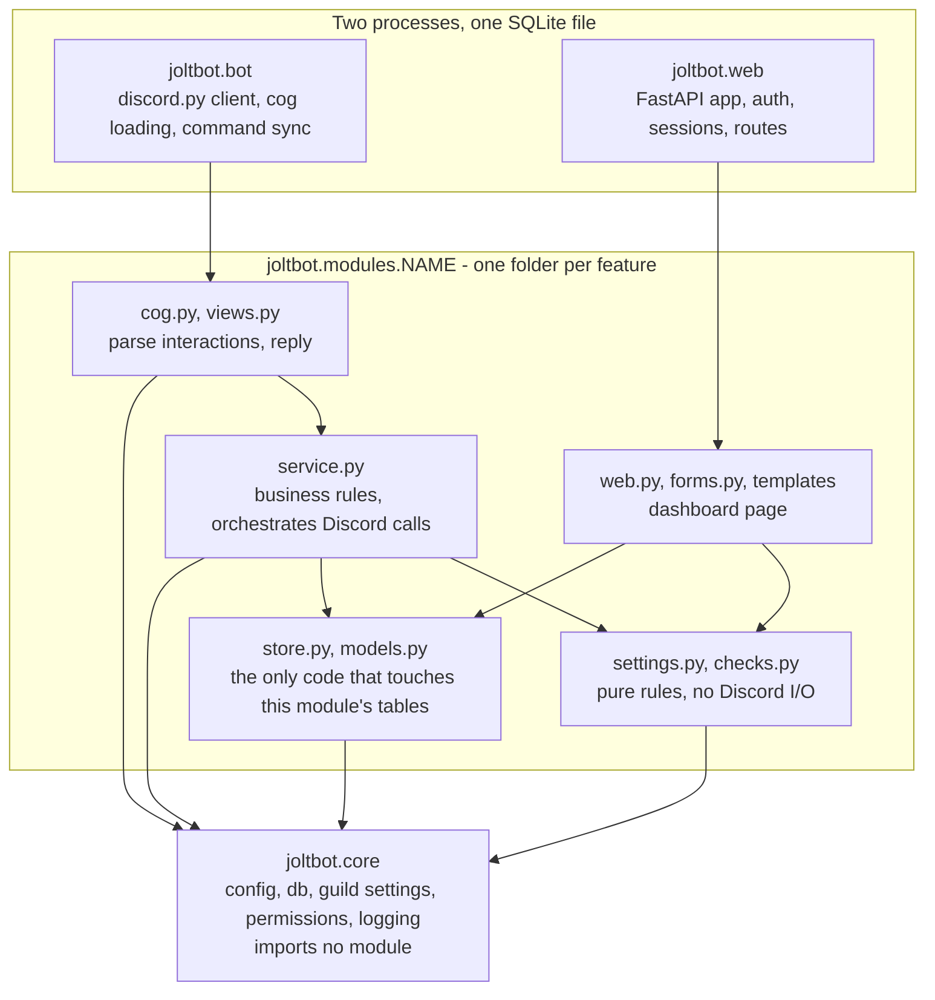

# JoltBot refactor plan

Based on [AUDIT.md](AUDIT.md) (commit `3129da6`). Nothing below starts until this plan is approved, and each phase stops for approval before the next.

## 1. What this plan is

The brief lists seven phases for turning a flat bot into a layered one. The audit found that most of that work already exists on `main`. This plan keeps the brief's phase numbers so progress is easy to follow, but each phase now contains only what the audit found missing.

| Phase | Brief | Status on `main` | Work left |
|---|---|---|---|
| 1 | Safety net | Lint and 434 tests exist | Type checker, contract tests, smoke checklist |
| 2 | Config and secrets | Done | Three small hardening proposals |
| 3 | Layering | Mostly done | Five targeted moves |
| 4 | Per-guild config | Done | None. Slot reused for the module seam |
| 5 | Reliability | Mostly done | Shared error reply, log context, bug-register fixes |
| 6 | Docs and CI | Mostly done | Decision records, diagram, CI type check |
| 7 | Deployment | Live | None planned |

## 2. Rules for every phase

These restate the brief's constraints as checks I run before each commit.

- **Contract.** AUDIT.md section 3 is frozen: command names, parameters, descriptions, permission checks, all 11 `custom_id`s, message texts, role outcomes, table schemas, routes. From Phase 1 on, tests enforce the first three.
- **No schema change.** `alembic revision --autogenerate` must produce an empty migration after every phase that touches models.
- **No new runtime dependency** without asking. Dev dependencies are listed in section 4 for approval.
- **Branch** `refactor/architecture` only. No push to `main`, no deploy, no run against the live token. Local runs use the JoltBot Test application.
- **Bugs** found along the way go into the bug register. A fix is its own commit, after approval.
- **After each phase:** commit, then report what changed, the concept behind each change in one line, the checks run with their real output, and the smoke-test steps to run in the test server.
- **Checks per phase:** `ruff check .`, `ruff format --check .`, `mypy` (from Phase 1), `pytest`.

## 3. Target architecture

The current shape stays. The change is in which way dependencies point and where a module's parts live.

What changes from today:

1. `core/` stops importing `modules/` (audit D4). The registry is handed to `core` functions, or lives below them.
2. Services stop importing views (D5). The service returns a result; the view decides what to show.
3. A module declares everything it owns in its own folder: tables, the bot permissions it needs, its service. Shared files stop growing with every feature (D1 to D3).
4. Helpers used by two modules move out of `tickets/` into a shared place (D7, D9).

**Deviation from the brief, with reason.** The brief wants a service layer "importing as little of discord as practical". The three services will keep importing `discord`. Their job is ordering Discord calls correctly: claim, give roles, then remove the pending role, send the DM, post the log, delete the channel, and undo the right steps when one fails. Hiding `discord.Member` and `discord.Guild` behind an interface would add a layer that only the fakes in `tests/fakes.py` would implement a second time, and the tests already drive these services without a connection. The rules that can be pure already are: `checks.py`, `settings.py`, `forms.py`, `diagnostics.py`. I will move any remaining pure decision out of a service when I find one, and leave the orchestration where it is.

## 4. Decisions needed from you

1. **Dev dependencies.**
   - `mypy`: needed for Phase 1. Chosen over pyright because Pydantic ships a mypy plugin and SQLAlchemy 2 is typed for it.
   - `pytest-cov`: optional. Gives a coverage number for the README; I would not gate CI on it.
   - `pip-audit`: optional, CI only. Checks the lock files for known vulnerabilities.
2. **Where mod log lands.** `feat/modlog` is uncommitted and edits the same shared files Phase 4 reshapes. My recommendation: finish and merge mod log before Phase 4. It is the real test of whether the new seam works, and it avoids rebasing unfinished work across a moved file. Phases 1 to 3 do not conflict with it, apart from `tests/fakes.py`, which both touch lightly.
3. **Security fixes that change behavior** (Phase 2). Each needs a yes or no:
   - `hide_parameters=True` on the engine (audit S1). Changes log text only. Recommended.
   - Delete expired sessions on a timer, not only at login (B5). Recommended.
   - Refuse to start the dashboard when `SESSION_SECRET` is shorter than 32 characters (S5). Low value, and it would stop the live dashboard from starting if the production secret is shorter than that, so check its length first. Optional.
4. **Encrypting stored access tokens** (S2). Needs the `cryptography` package at runtime. Options: (a) leave as is, with the existing mitigations; (b) add the dependency and encrypt with a key derived from `SESSION_SECRET`; (c) stop storing the token and re-fetch the server list only at login, which shortens how fresh permissions are. I recommend (a) for now and a decision record explaining why.
5. **Rate limiting** (S3). Cheapest option is a `rate_limit` block in `deploy/Caddyfile`, which needs a Caddy plugin build and touches deploy files, so it waits for Phase 7 in any case.

## 5. Phases

### Phase 1: Safety net

Goal: make the contract in AUDIT.md section 3 fail CI when it changes, before any code moves.

| Change | Files | Concept |
|---|---|---|
| Add mypy, non-strict to start, with the Pydantic plugin; run it in CI | `pyproject.toml`, `requirements-dev.txt`, `requirements-dev.lock`, `.github/workflows/ci.yml` | Static typing as a regression net |
| Fix or annotate what mypy reports. Anything that looks like a real bug goes to the register, not into this commit | scattered, annotations only | Types document intent |
| Snapshot test of the command tree: names, parameters, descriptions, default permissions, guild-only | `tests/test_contract.py` (new) | Contract test |
| Test that all 11 `custom_id`s are registered after the cogs load, with the legacy four spelled out as literals | `tests/test_contract.py` | Contract test |
| Concurrent-click tests through the views: two staff confirm Accept at once on one ticket; two reviewers on one alliance request | `tests/test_ticket_flow.py`, `tests/test_alliance_flow.py` | Race condition test |
| One parametrized test over every POST route: no CSRF token, wrong Origin, and another server's ID | `tests/test_web_access.py` | Table-driven test |
| Tests for login failure paths: missing scope, `error=`, Discord failing mid-callback | `tests/test_web_access.py` | Negative-path coverage |
| Manual smoke-test checklist built from the inventory | `docs/refactor/SMOKE_TEST.md` (new) | Acceptance checklist |

Risk: low. Tests and tooling only. The one way this phase can touch behavior is a type fix that changes logic; I will not make those here.

Unknown: how many errors mypy reports. If it is more than a short session's worth, I will enable it per package (`core` first) and say so in the report.

### Phase 2: Config and secrets

Typed settings and per-guild IDs are done. What is left is small and each item is separately approved (decision 3).

| Change | Files | Concept |
|---|---|---|
| `hide_parameters=True`, plus a test that a failed insert's error text does not contain the token | `core/db.py`, `tests/test_deploy.py` | Secrets never reach logs |
| Periodic purge of expired sessions from the dashboard process | `web/sessions.py`, `web/app.py` | Data minimization |
| Pass the loaded config into `run_once` (D10) | `bot/__main__.py` | Explicit dependencies |
| Remove the unused Google Fonts allowance from the CSP (S7) | `web/app.py` | Least privilege |
| Comment on `FORWARDED_ALLOW_IPS: "*"` explaining why it is safe | deferred to Phase 7 (deploy file) | n/a |

Risk: low. No Discord-facing behavior changes.

### Phase 3: Layering

Goal: make the dependency arrows in section 3 true. No behavior change; every step is a move or an inversion, covered by Phase 1.

| Step | Change | Files | Concept |
|---|---|---|---|
| 3a | Move the `PanelMessage` read and write out of the tickets cog into one shared pair of functions used by both modules (D6) | `tickets/cog.py`, `alliances/store.py`, new `core/panels.py` | Data-access layer; remove duplication |
| 3b | Move helpers that are not ticket-specific out of `tickets/`: `ts`, `clip`, `hierarchy_problems`, `roles_by_id`, `AssignableRole`, `form_options`, form parsing helpers, the powerful-role rule (D7, D9) | new `modules/common/`, imports in both modules | Shared kernel instead of sideways coupling |
| 3c | Break the service-to-view imports (D5): message constants move to `constants.py`; the service receives a view factory when it is built | `tickets/service.py`, `alliances/service.py`, both `views`, both `cog.py` | Dependency inversion |
| 3d | Move inline queries out of route handlers into `core/` functions (D8) | `web/routes/guild.py`, `web/routes/pages.py`, `web/security.py`, `core/issues.py`, `core/guilds.py`, new `core/audit.py` | Data-access layer |
| 3e | Move `BotMeta` reads and writes out of the client into `core/` | `bot/client.py`, new `core/meta.py` | Data-access layer |

Left alone on purpose: views reading the store for a pre-check (D11) and `web/sessions.py` (D12). Both are noted in the audit as not worth the churn.

Risk: medium. Steps 3b and 3c touch the files that run every accept, deny and alliance decision. Mitigation: one step per commit, the full suite after each, and the smoke checklist after 3c.

### Phase 4: The module seam

Per-guild config needs no work. This slot goes to the brief's second goal: a new feature should be a new module, not edits across the codebase.

| Step | Change | Files | Concept |
|---|---|---|---|
| 4a | Each module owns its tables in `modules/<name>/models.py`. `core/models.py` keeps only shared tables. Alembic and the test database import models through the registry | `core/models.py`, `modules/*/models.py`, `migrations/env.py`, `core/db.py` | Cohesion: a feature's schema lives with the feature |
| 4b | `core/` stops importing the registry (D4). Functions that need the module list take it as an argument, supplied by `bot` and `web` at startup | `core/guild_settings.py`, `core/guilds.py`, their callers | Dependency direction |
| 4c | A module declares the bot permissions it needs in its `ModuleInfo`. The invite value is computed from the registry (D3) | `modules/registry.py`, `core/permissions.py`, `web/rendering.py` | Open/closed |
| 4d | Replace the per-module attributes on the bot (`bot.tickets`, `bot.alliances`) with a typed lookup, for example `bot.service(TicketManager)` (D1) | `bot/client.py`, call sites in views and cogs, `tests/fakes.py` | Service locator scoped to the composition root |
| 4e | Update the "adding a module" docs and `tests/example_module/` to match, so the documented steps are executed by a test | `README.md`, `CONTRIBUTING.md`, `docs/ARCHITECTURE.md`, `tests/example_module/` | Documentation as a tested artifact |

Step 4a is the one with a hard gate: after the move, `alembic revision --autogenerate` must produce no operations and `tests/test_migrations.py` must pass. If either fails, the step is reverted, not patched.

Step 4c must produce exactly today's permission value, `2251800082377874` (it grew by View Audit Log when mod log merged). `tests/test_permissions.py` pins the number.

Risk: medium. Wide but shallow: many import lines, no logic. See decision 2 about doing this after mod log merges.

### Phase 5: Reliability

Most of the brief's list exists: central slash-command handler, persistent views, atomic decisions, recovery loop, clean shutdown on SIGTERM. What is left:

| Change | Files | Concept |
|---|---|---|
| A shared base view and base modal whose `on_error` logs and replies. All 13 component classes inherit it, which also fixes B1 | new `bot/components.py`, both modules' views, `tickets/cog.py` | Central error handling; safe by default |
| Log context: a `contextvars`-based filter that adds `guild_id`, `user_id`, `interaction_id` and `process` to every record, set once where an interaction or request enters | `core/logsetup.py`, `bot/client.py`, `web/app.py` | Structured logging with correlation fields |
| Convert "Guild %s: ..." message prefixes to structured fields where the context filter makes them redundant. Text format keeps showing the guild ID | modules' log calls | Structured logging |
| Fix B2: take the grant lock when the command starts, release it when the prompt is cancelled, times out or finishes | `tickets/cog.py` | Check-then-act race |
| Fix B3: read the access roles and save in one transaction | `tickets/web.py`, `alliances/web.py`, `core/guild_settings.py` | Atomicity |

B1, B2 and B3 are bug fixes. Each is a separate commit that I show you before making, per the brief.

Risk: medium for the base view (it sits under every button). The reply text of existing handlers is preserved exactly; a test asserts each one.

### Phase 6: Docs and CI

| Change | Files | Concept |
|---|---|---|
| Decision records, one page each: two processes over one SQLite file; settings as versioned JSON per module; compare-and-set state machines for decisions; the module registry; fail-closed dashboard authorization; hash-pinned lock files; services orchestrate Discord directly; access tokens stored as they are (decision 4) | `docs/adr/0001` to `0008` | Architecture decision records |
| Replace the ASCII diagrams with mermaid: processes and layers, ticket lifecycle, alliance request lifecycle | `docs/ARCHITECTURE.md` | Diagrams that render on GitHub |
| A short opening section for a reader evaluating the code: what it does, the three hardest problems and where each is solved, how to run the tests | `README.md` | Write for the reader |
| Fix the drift listed in audit section 9 | `docs/ARCHITECTURE.md`, `README.md`, `DEPLOYMENT.md` | Docs match code |
| CI: mypy step (from Phase 1), actions pinned by commit SHA, job timeouts, a concurrency group that cancels superseded runs; `pip-audit` if approved | `.github/workflows/ci.yml` | Supply-chain hygiene |

Risk: low.

### Phase 7: Deployment

Already live on Lightsail with Docker Compose, Caddy, restart policies, health checks, nightly backups and `DEPLOYMENT.md`. Nothing is planned, and per the brief no deploy file is touched before phases 1 to 6 are approved.

Candidates to decide on later, none urgent: `no-new-privileges`, `cap_drop` and a read-only root filesystem in Compose; base images pinned by digest; Caddy rate limiting (decision 5); the comment on `FORWARDED_ALLOW_IPS`.

## 6. Order and size

| Order | Phase | Depends on | Rough size |
|---|---|---|---|
| 1 | Phase 1 | mypy approval | 1 session, more if mypy is noisy |
| 2 | Phase 2 | decision 3 | Under 1 session |
| 3 | Phase 3 | Phase 1 | 1 to 2 sessions |
| 4 | Mod log merges to `main` | you | n/a |
| 5 | Phase 4 | Phases 1 and 3, mod log | 1 to 2 sessions |
| 6 | Phase 5 | Phase 4 for the base view's home | 1 session |
| 7 | Phase 6 | everything above | 1 session |

Phases 5 and 6 can swap with Phase 4 if mod log takes longer, since neither depends on the seam.

## 7. What I am not proposing

- A repository or unit-of-work abstraction over SQLAlchemy. The `store.py` functions already are the data-access layer, and they are short.
- A dependency-injection framework. Passing `bot`, `db` and `config` explicitly is enough at this size.
- A settings cache. Reading `module_settings` on every event is what makes dashboard changes apply at once, and SQLite handles it.
- Switching to Postgres. The brief keeps the storage engine.
- Rewriting the views as `DynamicItem`s. Looking a ticket up by channel ID works and keeps every posted `custom_id` valid.

## 8. Progress

| Phase | State | Commits | Audit items closed |
|---|---|---|---|
| 0 Audit and plan | Done, 2026-11-23 | `140221b` | n/a |
| 1 Safety net | Done, 2026-11-23 | `736e4a9`, `af167e7` | Test gaps T1, T2, T3, T5, T6, T7. New bug B7 recorded |
| 2 Config and secrets | Done, 2026-11-23 | `d0c2526` | S1, B5, D10, and the font hosts in S7 |
| 3 Layering | Not started | | |
| Mod log merged to `main` | Done, 2026-11-23. Not deployed | see `git log` | Phase 4 is unblocked |
| Mod log dashboard page | Done, 2026-11-23. Slash commands still to come | see `git log` | n/a |
| Mod log retention cleanup | Done, 2026-11-23, on `feat/modlog`. Not merged, not deployed | `bde05dd`, `97a5fa3` | The open item in AUDIT.md 3.9 |
| 4 Module seam | Not started | | |
| 5 Reliability | Not started | | |
| 6 Docs and CI | Not started | | |
| 7 Deployment | Nothing planned | | |

Decisions taken on 2026-11-23:

- Dev dependencies: `mypy` only. No `pytest-cov`, no `pip-audit`.
- Mod log merges to `main` before Phase 4.
- `SESSION_SECRET` minimum length: not added.
- Stored access tokens: left as they are (decision 4, option a).
- No test bot. The JoltBot Test application was deleted and is not being replaced, so there is no manual smoke test between phases. The automated tests are the check before a release, and `SMOKE_TEST.md` is run on the live server after one.
